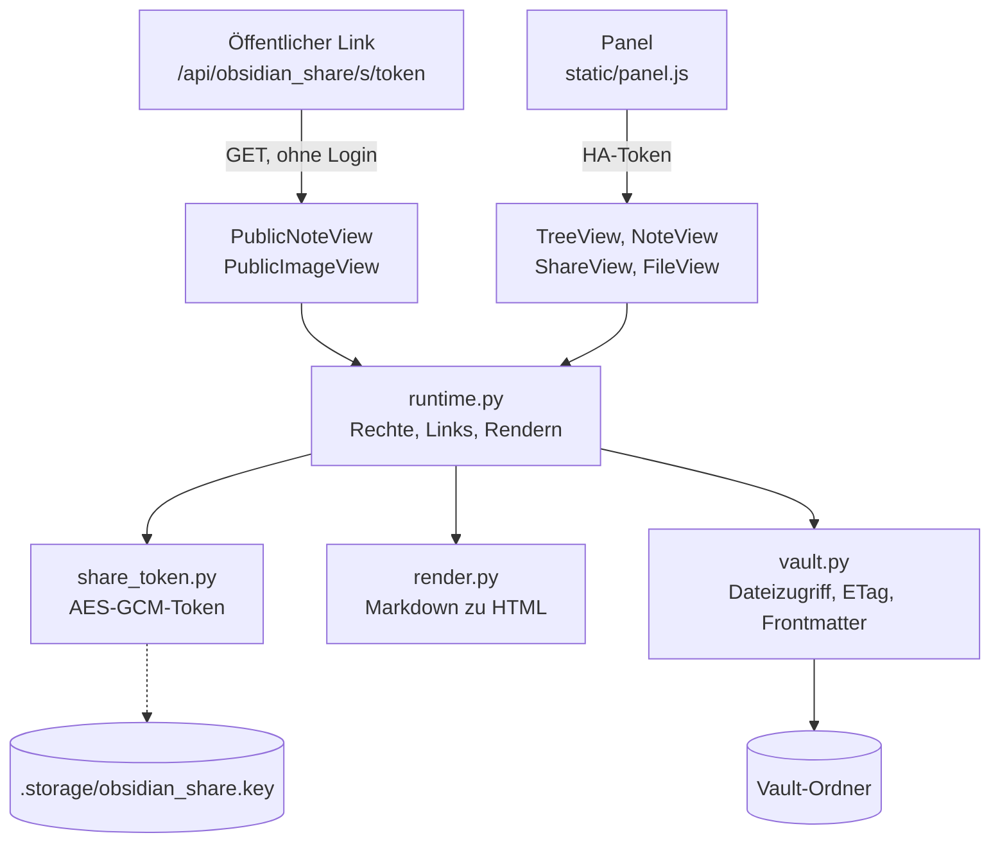

# Obsidian Share für Home Assistant

Custom Integration, die Notizen aus einem Obsidian-Vault auf dem Home-Assistant-Host

- als **öffentlichen Nur-Lese-Link** teilt (optional mit Ablaufdatum) und
- in einem **Seitenleisten-Panel** lesbar und bearbeitbar macht (hinter dem HA-Login, mit Rechten pro Nutzer).

Gedacht als selbst gehostete Alternative zu Share-Diensten: kein zusätzlicher Container, kein Reverse Proxy, die Links laufen über die externe URL von Home Assistant.

## Funktionen

- Freigabe per Frontmatter `ha_share: true`. Flag entfernen beendet die Freigabe sofort.
- Links enthalten einen AES-GCM-verschlüsselten Token (Pfad und Ablauf sind nicht sichtbar, nichts wird gespeichert).
- Aktion `obsidian_share.rotate_key` widerruft alle Links auf einmal.
- Aktion `obsidian_share.get_link` für Automationen und Skripte (liefert die URL als Antwort).
- Panel: Notizbaum mit Suche, gerenderte Ansicht mit Inhaltsverzeichnis, Callouts, Wikilinks, eingebetteten Bildern und Aufgaben, Editor mit Konflikterkennung.
- Rechte: Admins dürfen alles, weitere Nutzer als „bearbeiten“ oder „nur lesen“ eintragbar, alle anderen haben keinen Zugriff.

## Architektur



| Modul | Aufgabe |
| :-- | :-- |
| `__init__.py` | Einrichtung, Aktionen `get_link` und `rotate_key`, Panel- und Static-Registrierung |
| `config_flow.py` | Vault-Pfad beim Einrichten, Optionen für Rechte und externe URL |
| `views.py` | HTTP-Endpunkte: zwei öffentliche (Notiz, Bild), vier mit HA-Login (Baum, Notiz, Freigabe, Datei) |
| `runtime.py` | Rechteprüfung, Link-Erzeugung, Rendern für Panel und öffentliche Seite |
| `share_token.py` | Token aus verschlüsseltem Pfad und Ablauf, nichts wird gespeichert |
| `vault.py` | Abgeschotteter Dateizugriff, atomares Schreiben mit ETag, Frontmatter |
| `render.py` | Obsidian-Markdown zu HTML ohne Roh-HTML, plus öffentliche Seite |
| `static/panel.js` | Seitenleisten-Panel als Web Component, ohne Build-Schritt |

Der Schlüssel liegt in `.storage/obsidian_share.key`, nicht im Integrationsordner. Ein Update per HACS lässt Links daher gültig, `rotate_key` oder das Entfernen der Integration macht sie ungültig.

## Installation (HACS)

1. HACS → Menü (⋮) → **Benutzerdefinierte Repositories** → `https://github.com/kleinhansda/obsidian-share-ha`, Typ **Integration**.
2. „Obsidian Share“ installieren und Home Assistant neu starten.
3. Einstellungen → Geräte & Dienste → Integration hinzufügen → **Obsidian Share** → Vault-Pfad angeben (Standard `/share/syncthing/obsidian_vault`).
4. Optional in den Optionen: Bearbeiter, Leser und eine abweichende externe URL für Links.

> [!WARNING]
> Wenn die Integration vorher manuell nach `/config/custom_components/obsidian_share/` kopiert wurde, ersetzt HACS diesen Ordner vollständig. Vorher ein HA-Backup anlegen. Der Schlüssel für die Links liegt in `.storage/obsidian_share.key` und bleibt erhalten, bestehende Links funktionieren also weiter.

## Benutzung

Im Panel „Obsidian“ eine Notiz öffnen → **Teilen …** → Gültigkeit wählen → Link kopieren.

Per Aktion:

```yaml
action: obsidian_share.get_link
data:
  path: Projekte/Beispiel.md
  days: 30
response_variable: link
```

Die Notiz muss dafür `ha_share: true` im Frontmatter haben.

## Sicherheit

Der öffentliche Endpunkt `/api/obsidian_share/s/<token>` ist ohne Login erreichbar. Deshalb:

- nur GET, nur Notizen mit `ha_share: true`
- Pfade strikt auf den Vault begrenzt, versteckte Ordner (`.obsidian`, `.trash`, `.stfolder`) und Symlinks nach außen unsichtbar
- ungültige, abgelaufene und nicht freigegebene Links liefern dieselbe 404-Seite
- Bilder nur, wenn die freigegebene Notiz sie selbst einbettet, adressiert per Index
- Roh-HTML in Notizen wird nie ausgegeben, `%%Kommentare%%` werden entfernt, externe Bilder nicht nachgeladen
- CSP ohne Skripte, SVGs in einer CSP-Sandbox, `Referrer-Policy: no-referrer`, `noindex`

## Hinweise zu Syncthing

Beim Speichern schreibt die Integration atomar über eine Temp-Datei `.os-*.tmp` im selben Ordner. Damit Syncthing diese nicht mitsynchronisiert, in die `.stignore` des Vaults eintragen:

```
.os-*.tmp
```

Empfohlen außerdem: Dateiversionierung für den Vault-Ordner in Syncthing aktivieren.

## Entwicklung

```bash
pip install pytest pyyaml cryptography markdown-it-py mdit-py-plugins
pytest -q tests
```

Die Tests decken Token, Vault-Abschottung, Frontmatter und Rendering ab und laufen ohne Home Assistant.

## Umsetzungsstand

Version 0.2.0, Stand 18.10.2026.

**Erledigt**

- Alle Module, Panel, Optionen für Rechte und externe URL, Aktionen `get_link` und `rotate_key`, Übersetzungen (de, en), HACS-Struktur.
- 23 automatische Tests für `share_token`, `vault` und `render` (Token-Manipulation, Pfad-Ausbrüche, Symlinks, ETag-Konflikt, Frontmatter, XSS-Schutz, Callouts, Wikilinks). Sie laufen in der CI ohne Home Assistant.
- Panel-Logik in einem simulierten HA (jsdom) durchgespielt: Notizbaum, Öffnen, Teilen, Speichern mit ETag, Wikilink-Navigation.

**Offen**

- [ ] Installation und Test auf einem echten Home Assistant (2026.x): Config Flow, Panel-Registrierung, öffentlicher Link von außen.
- [ ] Integrationstests gegen Home Assistant. `__init__.py`, `config_flow.py`, `views.py` und `runtime.py` sind bisher nur syntaktisch geprüft, nicht automatisch getestet.
- [ ] Sichtprüfung des Panels im echten Frontend, Desktop und Handy.
- [ ] Repo-Topics auf GitHub setzen (z. B. `home-assistant`, `hacs`, `obsidian`), sonst schlägt der HACS-Check fehl.
- [ ] Release `v0.2.0` anlegen, damit HACS Versionen anbietet statt des letzten Commits.
- [ ] Brand-Icons für die Home-Assistant-Brands-Anzeige (im HACS-Check derzeit ignoriert).
- [ ] Betrieb: `.os-*.tmp` in die `.stignore` des Vaults und Syncthing-Dateiversionierung aktivieren (siehe oben).

## Lizenz

MIT
